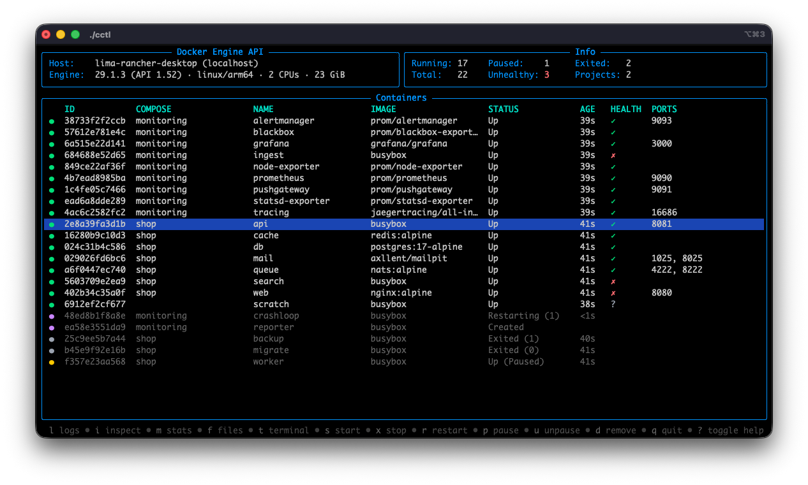

[](https://github.com/Br0ce/containerctl)
[](https://pkg.go.dev/github.com/Br0ce/containerctl)


# containerctl

A lightweight terminal UI for Docker container management, built for speed over remote SSH connections

---

## Overview

`containerctl` removes the friction from managing containers over SSH.
It’s a lightweight CLI that lets you instantly inspect, control, and tail logs from containers — perfect for remote servers where you want speed, not tooling overhead.

It sits as a thin layer between the [Bubble Tea](https://github.com/charmbracelet/bubbletea) TUI framework and the [Moby](https://github.com/moby/moby) Docker client. It supports connecting to a remote Docker Engine API directly over SSH, so you can manage containers on a remote host without SSHing in manually.

## TUI



The default view lists all containers on the connected host, with a colored dot showing each container's state. Select a container to:

- **Logs** — follow its output in real time.
- **Shell** — open an interactive shell inside the container.
- **Files** — browse the filesystem without a shell, which also works for stopped containers and distroless images, and copy files or directories to your machine.
- **Inspect** — view the container's configuration and details.
- **Stats** — watch live CPU, memory and network usage.

You can also start, stop, restart, pause and remove containers. Actions run in the background so the UI stays responsive; failures are reported briefly on the status line.

### Keys

| Key          | Page       | Action                                  |
|--------------|------------|-----------------------------------------|
| `l`          | containers | Stream logs                             |
| `t`          | containers | Open a shell in the container           |
| `f`          | containers | Browse the filesystem                   |
| `i`          | containers | Inspect container details               |
| `m`          | containers | Show live resource stats                |
| `s` / `x`    | containers | Start / stop                            |
| `r`          | containers | Restart                                 |
| `p` / `u`    | containers | Pause / unpause                         |
| `d`          | containers | Remove (confirm with `y`)               |
| `Enter`      | files      | Open directory                          |
| `c`          | files      | Copy file or directory to local         |
| `r`          | inspect    | Refresh details                         |
| `e`          | inspect    | Show / hide environment values          |
| `Esc`        | any        | Back to the container list              |
| `?`          | any        | Toggle full help                        |
| `q`          | any        | Quit                                    |

The footer shows the keys available in the current view.

## SSH

When `--host` is provided, containerctl connects to the remote Docker Engine API over SSH, tunneling all API calls through the connection. No manual SSH session is needed.

The SSH behavior is designed to mirror OpenSSH: `~/.ssh/config` is read and its values take precedence over command-line arguments. Host keys are verified against `~/.ssh/known_hosts`. Authentication follows the same order as OpenSSH — password prompt, SSH agent (`SSH_AUTH_SOCK`), or a private key file, with a passphrase prompt if the key is encrypted. A key given with `--identity-file` must be inside `~/.ssh`.

## Docker socket

Locally, cctl connects to `--docker-host` if given, otherwise to `DOCKER_HOST`, otherwise to `unix:///var/run/docker.sock`. With `--host`, `--docker-host` names the socket on the remote host (default `/var/run/docker.sock`) and of the Docker environment variables only `DOCKER_API_VERSION` is used. This also lets you connect to Docker API-compatible engines such as Podman.

### Examples

```bash
  # Connect to local Docker
  cctl

  # Connect to local Podman
  cctl --docker-host unix:///run/user/1000/podman/podman.sock

  # Connect to remote host using default SSH settings
  cctl --host my-host

  # Connect to remote host using an SSH key
  cctl --host my-host:23 --identity-file ~/.ssh/id_rsa

  # Connect to remote host with username embedded in host and password prompted
  cctl --host username@my-host --ask-password
```

## Install

Download the binary for your platform from the [releases page](https://github.com/Br0ce/containerctl/releases).

### macOS (Apple Silicon)

```sh
VERSION=v1.0.0-rc.1  # replace with the desired version
curl -LO https://github.com/Br0ce/containerctl/releases/download/${VERSION}/containerctl-${VERSION}-darwin-arm64

# Verify the checksum against the value published on the releases page
shasum -a 256 containerctl-${VERSION}-darwin-arm64

chmod +x containerctl-${VERSION}-darwin-arm64
sudo mv containerctl-${VERSION}-darwin-arm64 /usr/local/bin/cctl
cctl --version
```

### Linux (amd64)

```sh
VERSION=v1.0.0-rc.1  # replace with the desired version
curl -LO https://github.com/Br0ce/containerctl/releases/download/${VERSION}/containerctl-${VERSION}-linux-amd64

# Verify the checksum against the value published on the releases page
sha256sum containerctl-${VERSION}-linux-amd64

chmod +x containerctl-${VERSION}-linux-amd64
sudo mv containerctl-${VERSION}-linux-amd64 /usr/local/bin/cctl
cctl --version
```

---

## Install from Source

Requirements

- Go 1.27+

```sh
git clone https://github.com/Br0ce/containerctl.git
cd containerctl
make build
```

The binary will be placed at `./bin/cctl`.

### Usage

```sh
./bin/cctl
# or
make run
```

## Development

Install dependencies and tooling:

```sh
make setup
```

Available make targets:

| Target         | Description                          |
|----------------|--------------------------------------|
| `build`        | Build the binary to `./bin/`         |
| `run`          | Run directly via `go run`            |
| `test`         | Run tests (short, parallel)          |
| `test-v`       | Run tests with verbose output        |
| `test-race`    | Run tests with race detector         |
| `lint`         | Run golangci-lint                    |
| `format`       | Format code with `go fmt`            |
| `tidy`         | Tidy and vendor dependencies         |
| `clean`        | Remove build artifacts               |
| `demo-up`      | Start the demo containers            |
| `demo-down`    | Remove the demo containers           |

## License

Apache 2.0 — see [LICENSE](LICENSE).
